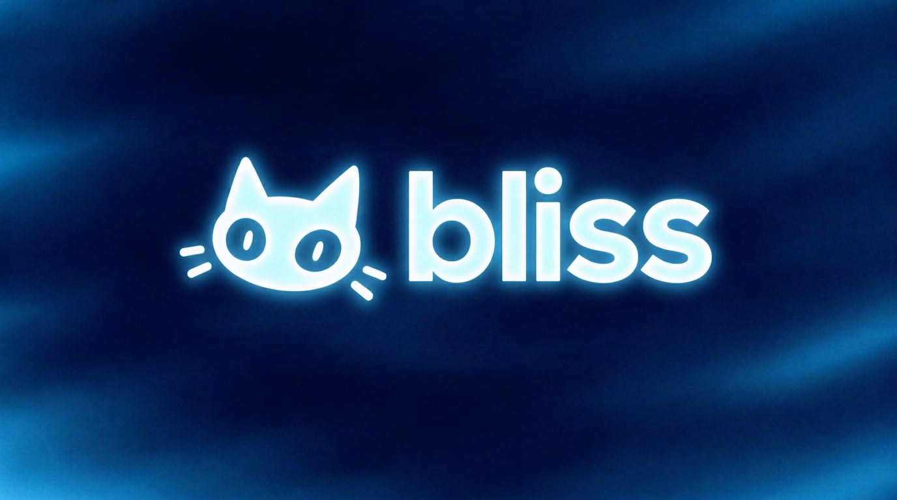

# bliss ✨ — the (intentionally) over-the-top Discord bot landing page

A single-page, zero-build marketing site for **bliss**, the AI companion your Discord server deserves™.
Glowing cat, glassmorphism, animated counters, fake social proof, a cookie banner — the full
"AI-generated startup landing page" experience, hand-tuned so it's actually usable.



---

## What's in here

```
.
├── index.html      # all the markup + copy
├── styles.css      # design system, layout, animations, responsive rules
├── script.js       # interactions (no dependencies, no build step)
├── 404.html        # custom Pages not-found page
├── .github/
│   └── workflows/
│       └── pages.yml   # deploy to GitHub Pages on push to main
└── assets/
    ├── banner.jpg      # wide logo (og:image + faint CTA background)
    ├── banner.png      # original supplied banner
    ├── pfp-small.png   # 512px cat mark used throughout the page
    ├── favicon.png     # 96px favicon
    └── pfp.png         # original supplied profile picture
```

No frameworks, no bundler, no `node_modules`. Open `index.html` or serve the folder.

## Run it locally

```bash
python3 -m http.server 8000
# → http://localhost:8000
```

Or any static server (`npx serve`, `php -S`, Caddy, nginx…). It also works when opened directly
from the filesystem, though a server is nicer for the clipboard API.

## Sections

1. **Hero** — headline, dual CTA, rating proof, fake live Discord chat window with floating stat cards.
2. **Logo marquee** — infinite scroll of "communities that use Bliss".
3. **How it works** — 3 steps, 30 seconds, no dashboards.
4. **Features** — bento grid: context-aware AI, latency sparkline, personality dial, command cloud,
   memory, AutoMod stats, scale, privacy.
5. **Stats band** — count-up numbers on scroll.
6. **Commands** — tabbed showcase (AI / Fun / Moderation / Utility), click any command to copy it.
7. **Comparison table** — Bliss vs. two suspiciously generic competitors.
8. **Testimonials** — masonry wall of love, all five stars, obviously.
9. **Pricing** — Free / Pro / Ultra with a monthly↔yearly toggle.
10. **FAQ** — details/summary accordion, one open at a time.
11. **Final CTA + footer** — status pill, uptime bars, "we're hiring".
12. **Extras** — cookie banner, rotating social-proof popup, toast notifications, triple-click the
    logo for a cat-shaped easter egg.

## Interactions

| Thing | Behaviour |
| --- | --- |
| Nav | Sticky, blurs on scroll, hamburger menu under 960px |
| Reveals | `IntersectionObserver` + staggered fade-up |
| Counters | Ease-out count-up, respects `prefers-reduced-motion` |
| Command chips | Click to copy the slash command, toast confirmation |
| Tabs | Keyboard-focusable buttons, swap command panels |
| Billing toggle | Rewrites `$9 → $7`, `$29 → $23` |
| Cookie banner | Session-scoped, Accept / Reject / Manage all "work" |
| Social proof | Rotates every ~9.5s once the cookie banner is gone; closable |
| Cursor | Soft glow follows the pointer, cards get a spotlight highlight |
| Logo ×3 | Emoji confetti + a small congratulations |

## Deploying (GitHub Pages)

The site ships with a workflow at `.github/workflows/pages.yml` that publishes it to
**<https://kilkproduct.github.io/Bliss/>**.

- **Triggers:** every push to `main`, plus manual runs via *Actions → Deploy to GitHub Pages → Run workflow*.
- **How it works:** the build job copies `index.html`, `styles.css`, `script.js`, `404.html` and the
  web-optimised assets into a `_site/` folder (with a `.nojekyll`), uploads it as a Pages artifact,
  then `actions/deploy-pages` publishes it — no build tools, no `npm install`.
- **One-time setup** (already done for this repo): *Settings → Pages → Build and deployment →
  Source: GitHub Actions*.
- **Permissions:** `contents: read`, `pages: write`, `id-token: write`, in a `pages` concurrency
  group so overlapping deploys queue instead of racing.
- **Custom 404:** `404.html` picks up the cat, the mesh background and a "wandered off" message.
  Its asset links use the `/Bliss/` project-path prefix — switch them to `/` if you move to a
  custom domain.

Any other static host works too: build the same `_site/` folder and serve it.

## Hooking it up to a real bot

Every CTA currently points at `#` and shows a polite "this is a demo" toast. Drop your real
invite URL into the relevant anchors in `index.html`:

```html
<a class="btn btn-primary" href="https://discord.com/oauth2/authorize?client_id=YOUR_ID&scope=bot+applications.commands">Add to Discord</a>
```

Grepping for `href="#"` finds all of them; the placeholder toast handler in `script.js` only fires
for links that still have `href="#"`.

## Customising the look

All colours and shared values live in `:root` at the top of `styles.css`:

```css
--bg:    #040a1c;  /* page background */
--cyan:  #7ff0ff;  /* primary glow  */
--violet:#9a7cff;  /* secondary     */
--pink:  #ff82dd;  /* tertiary      */
--grad:  linear-gradient(100deg, #b6f7ff, #6fe3ff, #8b9dff, #f3a8ff);
```

Swapping `--grad` re-themes the gradient text, primary buttons, bars and the comparison column.

## Notes

- **Fictional data.** 84,000 servers, 12.4M messages, 4.9/5 reviews, the comparison table and the
  social-proof popup are all made up for the bit. Replace them with real numbers before launch, or
  keep the joke and don't bill anyone.
- **Fonts** come from Google Fonts (Inter + JetBrains Mono) with a system fallback stack.
- **Accessibility:** semantic landmarks, skip-free but keyboard-navigable, `aria-selected` tabs,
  visible labels, `prefers-reduced-motion` support, and a `<noscript>` fallback so the page isn't
  invisible without JS.
- **Assets** are the two supplied images (`bliss_banner.png`, `bliss_pfp.png`), copied into `assets/`
  along with a compressed banner and 512px/96px cuts of the cat mark so the page stays light.
- Not affiliated with Discord. Please don't actually ship the fake SOC 2 badge to production.

---

Made with ❤ and an irresponsible amount of AI.
